<div align="center">

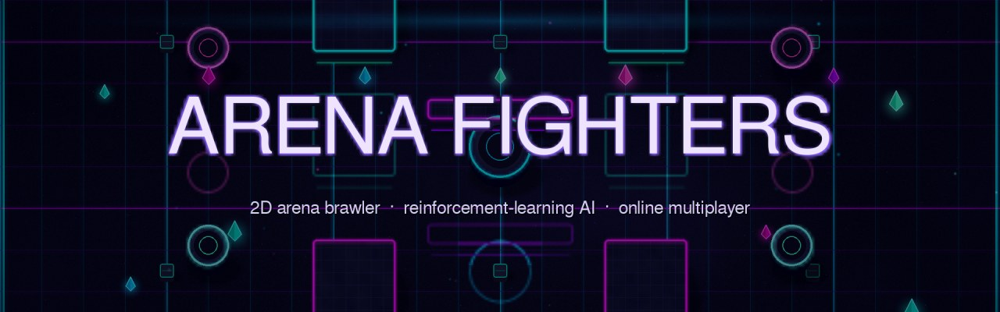

### 2D арена-борба со вештачка интелигенција истренирана со *reinforcement learning*

[](https://www.python.org/)
[](https://www.pygame.org/)
[](https://stable-baselines3.readthedocs.io/)
[](#-онлајн-мултиплеер)
[](#-самостојна-верзија-exe)
[](#-за-проектот)

[**Брз старт**](#-брз-старт) ·
[**VS Code**](#-пуштање-во-visual-studio-code) ·
[**Контроли**](#%EF%B8%8F-контроли) ·
[**AI**](#-како-работи-ai) ·
[**Онлајн**](#-онлајн-мултиплеер) ·
[**Галерија**](#%EF%B8%8F-галерија)

<br>

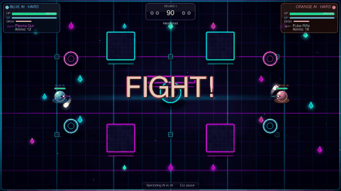

<sub>Вистинска снимка од играта: два AI агенти (Hard) се борат на мапата *Neon Void*.</sub>

</div>

---

## ✨ Што има во играта

<table>
<tr>
<td width="50%" valign="top">

### 🧠 Вистински истрениран AI
Невронска мрежа (PPO) учена со **self-play** низ илјадници борби.
Три тежини – **Easy · Medium · Hard** – од ист модел, со различна брзина на реакција и грешки.

</td>
<td width="50%" valign="top">

### 🌐 Онлајн мултиплеер
Игра со другар преку **LAN** (автоматски се наоѓате), **директна IP адреса** или **relay сервер** со код на соба – без port forwarding.

</td>
</tr>
<tr>
<td valign="top">

### 🗺️ 4 уникатни арени
Процедурално нацртани: шума со патека, каменолом на зајдисонце, древни урнатини со магичен круг и неонска празнина.
Секоја има свои честички, светла и 3D пречки.

</td>
<td valign="top">

### ⚔️ Динамична борба
Меч + 4 оружја за далечина што се појавуваат низ арената, dash, спринт и издржливост.
Best-of-3 рунди, **K.O.**, hit-stop, тресење на екран, бројки за штета и статистика.

</td>
</tr>
</table>

| Мод | |
|:--|:--|
| 🤖 **VS AI** | Ти против истренираниот AI – избираш тежина |
| 👥 **LOCAL 2P** | Двајца играчи на една тастатура |
| 👀 **AI VS AI** | Гледаш два AI агенти како се борат |
| 🌐 **ONLINE** | Со другар преку мрежа или интернет |

---

## 🚀 Брз старт

> [!IMPORTANT]
> Потребен е **Python 3.10 или понов** ([python.org](https://www.python.org/downloads/) – при инсталација штиклирај *„Add Python to PATH“*).
> За играње требаат само **pygame** и **numpy** – PyTorch **не** е потребен.

```bash
git clone https://github.com/Emanuel-8/Intelegentni-Sistemi.git
```
```bash
cd Intelegentni-Sistemi/Game
```
```bash
python -m pip install -r requirements.txt
```
```bash
python game.py
```

<details>
<summary><b>Директно во борба (без мени)</b></summary>

```bash
python game.py --mode ai --difficulty Hard     # против AI
python game.py --mode aivai                    # AI против AI
python game.py --mode local                    # двајца на една тастатура
python game.py --fullscreen                    # цел екран
```
</details>

> [!NOTE]
> Првото пуштање трае неколку секунди (*„Forging the arenas…“*) – тогаш се генерираат мапите. После се вчитуваат веднаш.

---

## 💻 Пуштање во Visual Studio Code

Репото доаѓа со готови поставки во `.vscode/`, па играта се пушта со **F5**.

1. **File → Open Folder…** и избери ја целата папка `Intelegentni-Sistemi` (не само `Game`).
2. Инсталирај ја екстензијата **Python** од Microsoft – VS Code сам ќе ја предложи.
3. `Ctrl+Shift+P` → **Python: Select Interpreter** → избери го твојот Python 3.10+.
4. **Terminal → Run Task… → „Инсталирај пакети за играње“** (само првиот пат).
5. Отвори **Run and Debug** (`Ctrl+Shift+D`), избери конфигурација и притисни **F5** ▶️

| Конфигурација | Што прави |
|:--|:--|
| 🎮 Arena Fighters (мени) | Нормално пуштање со главно мени |
| 🤖 Против AI – Hard | Веднаш борба против најтешкиот AI |
| 👀 AI против AI | Гледаш два AI агенти |
| 👥 Двајца на една тастатура | Локален мултиплеер |
| 🌐 Онлајн лоби | Директно во онлајн менито |
| 🛰️ Relay сервер | Го пушта серверот за онлајн преку интернет |
| 🏋️ Тренирај AI | Тренинг на нов модел (бара пакети за тренинг) |

> [!TIP]
> Може и поедноставно: отвори го `Game/game.py` и кликни на ▶️ горе десно (*Run Python File*).

<details>
<summary><b>Проблеми?</b></summary>

| Порака | Решение |
|:--|:--|
| `No module named 'pygame'` | Чекор 4 не поминал или е избран друг Python. Повтори ги чекорите 3 и 4. |
| `python` не се препознава (Windows) | Користи `py` наместо `python`, или реинсталирај Python со *Add to PATH*. |
| Се отвора старо мени без *ONLINE* | Не си на најновата верзија – `git pull`. |
| Firewall прашува при онлајн игра | Дозволи пристап (приватна мрежа). |

</details>

---

## 🕹️ Контроли

| Акција | Играч 1 / соло | Играч 2 (локално) |
|:--|:--:|:--:|
| Движење | <kbd>W</kbd><kbd>A</kbd><kbd>S</kbd><kbd>D</kbd> (соло: и стрелки) | <kbd>↑</kbd><kbd>←</kbd><kbd>↓</kbd><kbd>→</kbd> |
| Спринт | <kbd>Left Shift</kbd> | <kbd>Right Shift</kbd> |
| Dash | <kbd>Q</kbd> / <kbd>Space</kbd> | <kbd>/</kbd> |
| Удар (melee) | <kbd>F</kbd> / 🖱️ лев клик | <kbd>Right Ctrl</kbd> |
| Пукање | <kbd>E</kbd> / 🖱️ десен клик | <kbd>.</kbd> |

<kbd>Esc</kbd> пауза  ·  <kbd>F11</kbd> или <kbd>Alt</kbd>+<kbd>Enter</kbd> цел екран  ·  <kbd>M</kbd> звук вкл/искл

---

## 🧠 Како работи AI

AI-от го контролира играчот 2. Секој frame ја „гледа“ состојбата на играта како **32 броја** и избира акција. За време на тренингот добива награда за штета, победа и земање оружје, а казна за примена штета и пасивност.

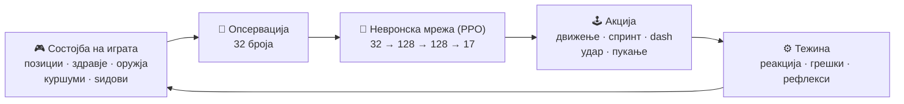

### Тежини

| | Реакција | Случајни потези (ε) | Избор | Рефлекси |
|:--|:--:|:--:|:--:|:--|
| 🟢 **Easy** | на секои 12 frames | 30 % | семплирање | ретки, основни |
| 🟡 **Medium** | на секои 4 frames | 6 % | семплирање | чести, основни |
| 🔴 **Hard** | секој frame | 0 % | најдобра акција | избегнува куршуми, казнува промашувања, нишани |

Сите нивоа користат и **BFS навигација** околу пречките – моделот не научил да оди околу ѕидови, бидејќи ботовите на тренинг секогаш доаѓаа кон него.

<details>
<summary><b>📊 Резултати од тестирање</b></summary>

30 борби против ботовите од тренингот (победи AI – порази – нерешено):

| | Rusher | Kiter | Dodger |
|:--|:--:|:--:|:--:|
| 🟢 Easy | 0–30–0 | 29–0–1 | 30–0–0 |
| 🟡 Medium | 9–21–0 | 30–0–0 | 30–0–0 |
| 🔴 Hard | **23–7–0** | **30–0–0** | **30–0–0** |

Меѓусебно: Medium – Easy **22–8**, Hard – Medium **21–9**, Hard – Easy **30–0**.

Невронската мрежа во играта работи со **numpy** (без PyTorch). Проверено е дека дава **идентични** акции како `PPO.predict` на 2.000 случајни состојби.

</details>

---

## 🌐 Онлајн мултиплеер

Хостот ја извршува играта, а другиот играч праќа само притиснати копчиња и прима состојба 60 пати во секунда (*host-authoritative*). Така правилата на играта постојат само на едно место.

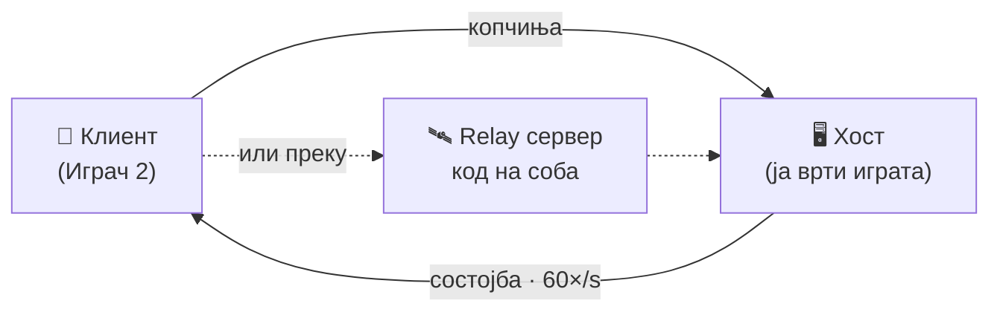

| Начин | Кога | Што правиш |
|:--|:--|:--|
| 🏠 **LAN / исто Wi-Fi** | Ист стан, иста мрежа | Еден: **Host Game**. Другиот ја гледа играта под *Games on your network* и кликнува. |
| 🔌 **Директно преку интернет** | Имаш пристап до рутерот или VPN | Отвори TCP порта `50555`, или користи [Tailscale](https://tailscale.com) / [playit.gg](https://playit.gg). Другарот ја пишува адресата во *Join*. |
| 🛰️ **Relay сервер** | Без port forwarding | На сервер со јавна IP: `python relay_server.py --port 7777`. Двајцата го пишуваат `адреса:7777` во *Relay server*, хостот добива **код на соба**, а другарот го внесува. |

---

## 🖼️ Галерија

<table>
<tr>
<td>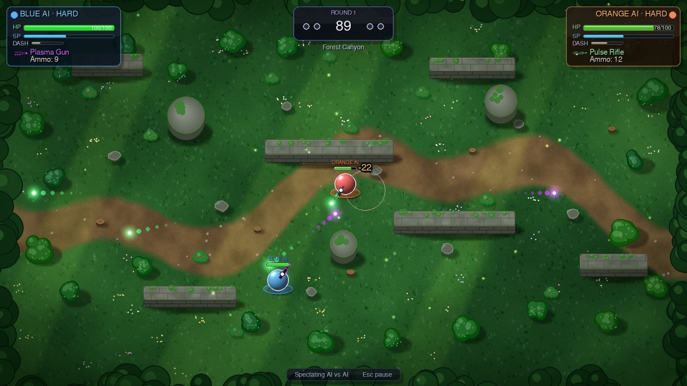<p align="center"><b>Forest Canyon</b></p></td>
<td>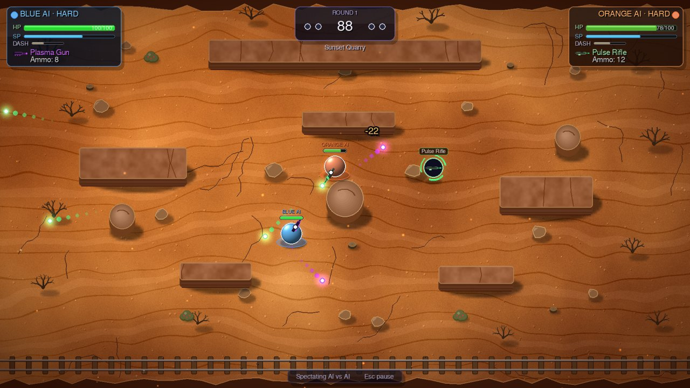<p align="center"><b>Sunset Quarry</b></p></td>
</tr>
<tr>
<td>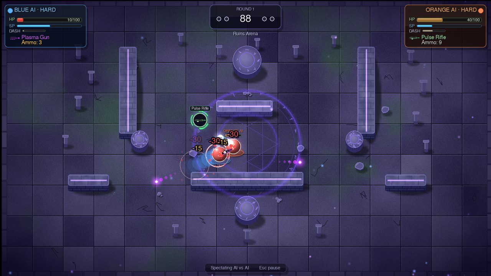<p align="center"><b>Ruins Arena</b></p></td>
<td>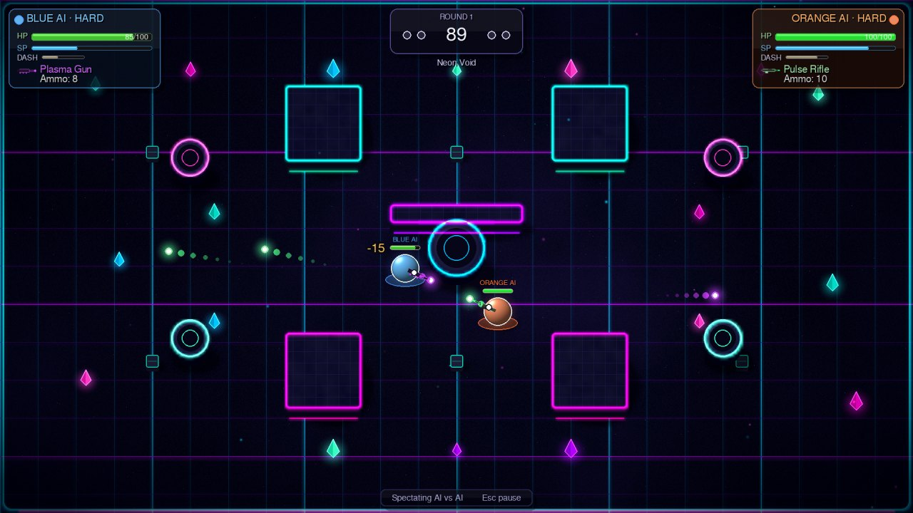<p align="center"><b>Neon Void</b></p></td>
</tr>
<tr>
<td>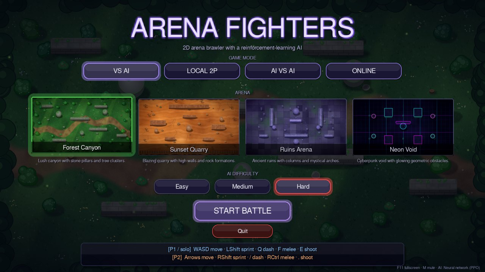<p align="center">Главно мени</p></td>
<td>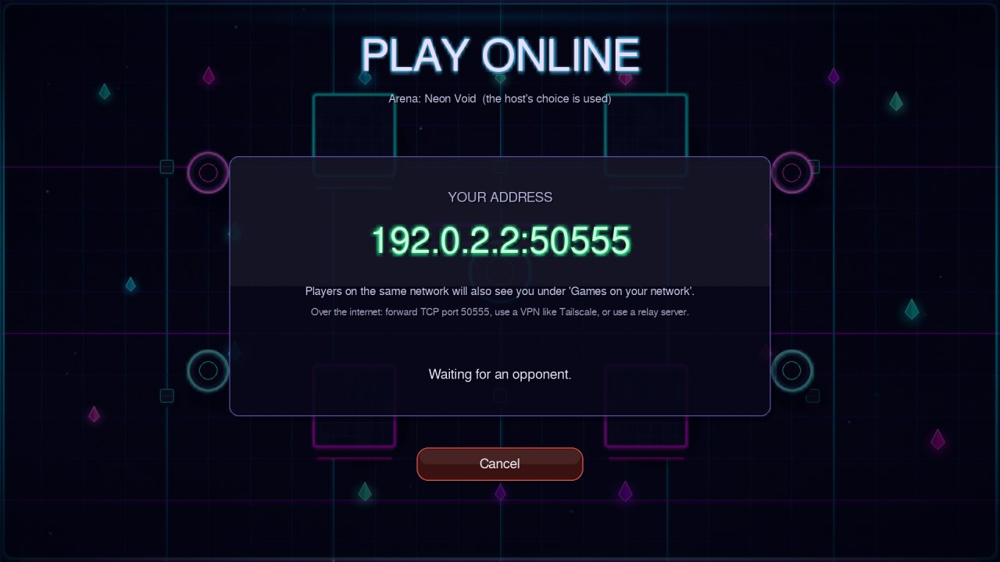<p align="center">Онлајн лоби</p></td>
</tr>
<tr>
<td>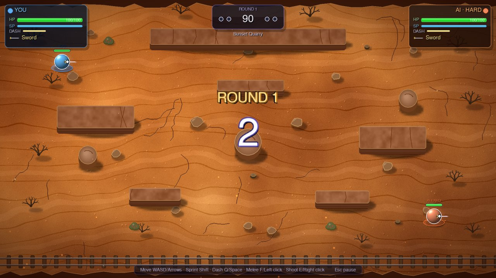<p align="center">Почеток на рунда</p></td>
<td>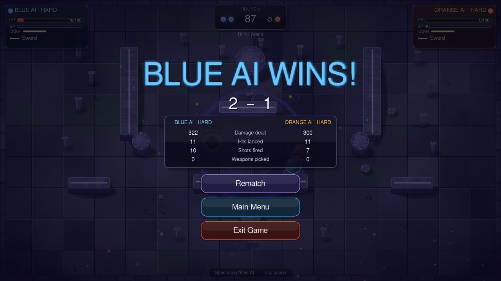<p align="center">Крај на меч со статистика</p></td>
</tr>
</table>

---

## 🏋️ Тренирање на нов AI

```bash
python -m pip install -r requirements-train.txt
```
```bash
python train_ai.py
```

Тренингот создава `p2_ai.zip` и автоматски го извезува `p2_ai_weights.npz` – датотеката што играта ја вчитува.
Деталното упатство (награди, хиперпараметри, решавање проблеми) е во [`Game/GUIDE.md`](Game/GUIDE.md).

---

## 📦 Самостојна верзија (.exe)

За другари без Python:

```bash
python -m pip install pyinstaller
```
```bash
python build_exe.py
```

Резултатот е во `Game/dist/` (`ArenaFighters.exe` на Windows). За сите три оперативни системи одеднаш: **Actions → Build game → Run workflow** на GitHub.

---

## 🗂️ Структура на проектот

```text
Intelegentni-Sistemi/
├── Game/
│   ├── game.py               🎮 играта: механики, мени, рунди, сите модови
│   ├── map_art.py            🎨 процедурална графика на мапите
│   ├── ai_player.py          🧠 AI во играта: тежини, рефлекси, навигација
│   ├── ai_helpers.py         🔢 опсервација (32 броја) – иста за тренинг и игра
│   ├── game_env.py           🏟️ Gymnasium околина за тренинг
│   ├── train_ai.py           🏋️ PPO тренинг
│   ├── export_ai_weights.py  📤 p2_ai.zip → p2_ai_weights.npz
│   ├── net.py                🌐 онлајн мултиплеер
│   ├── relay_server.py       🛰️ relay сервер за игра преку интернет
│   ├── sfx.py                🔊 звуци синтетизирани во кодот
│   ├── build_exe.py          📦 PyInstaller build
│   ├── p2_ai.zip             💾 истрениран модел (Stable-Baselines3)
│   └── p2_ai_weights.npz     💾 истиот модел за numpy
├── docs/images/              🖼️ слики за README
└── .vscode/                  💻 F5 конфигурации и задачи
```

---

## 🎓 За проектот

| | |
|:--|:--|
| **Наслов** | Arena Fighters |
| **Тип** | Машинско учење (reinforcement learning) |
| **Учесници** | Емануел Бајмак Грозданов · Филип Тодоров |
| **Алгоритам** | PPO (Proximal Policy Optimisation), Stable-Baselines3 |
| **Датасет** | Не е потребен – AI учи од self-play и награди |

<details>
<summary><b>📄 Оригинална пријава на проектот</b></summary>

#### 2. Наслов на проектот
**Arena Fighters**

---

#### 3. Тип на проект
Машинско учење

---

#### 4. Опис на проектот
Проектот е 2D боречка арена во која играчи можат да се борат со основни акции како движење, напад итн. Во арената се појавуваат оружја кои играчите можат да ги земат. AI агенти ќе можат да се борат меѓусебе или човек да игра против AI 
со избор на тешкотија. 

---

#### 5. AI API(и)
Доколку е потребно.
---

#### 6. Датасет
- **Не е потребен датасет**  
  - AI се учи преку **simulated self-play и награди** во играта.  
  - Секоја борба е генеративен податок за учење: состојба → акција → награда.  
  - Големина: зависи од број на тест-борби.  

---

#### 7. Карактеристики на проектот
1. **Player vs AI & AI vs AI борби** – два AI агенти можат да се борат меѓусебе, или човек да игра против AI.  
2. **Динамички оружја** – оружја се спавнуваат на случајни позиции и AI мора да ги зема за подобрување на перформансите.  
3. **Селектибилна AI тешкотија** – лесна, средна и тешка, реализирана преку прилагодување на ε-greedy истражувањето и брзината на реакција.  
4. **Основни боречки механики** – move, dash, attack, block, со cooldowns и ефекти на напад.  
5. **Визуелна 2D арена** – графички интерфејс со преглед на здравје, оружја и позиции на играчите.  

---

#### 8. Очекуван резултат
- Конечниот резултат е **интерактивна 2D игра** каде:  
  - Човек може да се бори против AI и да избира тешкотија.  
  - Два AI-та можат да се борат и да прикажуваат стратегии.  
  - Визуелно се прикажуваат играчите, оружјата, здравјето и арена.  
  - AI прогресира со време, учи да избегнува напади, да користи dash и block оптимално.

</details>

<div align="center">
<br>
<sub>Направено со 🐍 Python, 🎮 pygame и 🧠 многу борби против самиот себе.</sub>
</div>
